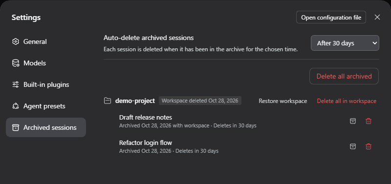

# Archive Cleanup for DeepSeek Harness

A plugin for [DeepSeek Harness](https://github.com/deepseek-ai/deepseek-harness) (DSH) that lets you actually delete sessions.

DSH can archive a session but never deletes one, so old conversations pile up on disk. Archive Cleanup adds a way to delete archived sessions for good, an optional auto-delete timer, and a restore path for workspaces you delete.



## Features

- **Delete permanently.** Archived sessions get a **Delete permanently** item in their ⋯ menu.
- **Archived sessions page.** **Settings → Archived sessions** lists everything in the archive, grouped by workspace like the sidebar. Each row shows when the session was archived and when it will be deleted. You can restore or delete one session, a whole workspace, or everything.
- **Auto-delete.** Choose **Never** (the default), or delete archived sessions after 1, 3, 7, 14, 30, 60, or 90 days. Each session has its own timer, which starts when that session was archived. Only sessions whose time is up are deleted.
- **Restorable workspaces.** When you delete a workspace, its sessions move to the archive instead of to *Ungrouped*. **Restore workspace** brings the workspace back for the same folder, with all its sessions in their original order. Restoring a single session from a deleted workspace also brings the workspace back.
- **Confirmation first.** Every permanent delete asks before it acts.

## Install

You need DeepSeek Harness 0.2.1-rc.3 or a later 0.2.x release, either the desktop app or `npx @deepseek-ai/dsh web`. The plugin is tested on 0.2.1-rc.3, the current desktop release, and on 0.2.2-alpha.2.

**From the app**

1. Open **Plugins** and click **Add plugin**.
2. Paste `https://github.com/emreasln/dsh-archive-cleanup` and click **Install**.
3. **Settings → Archived sessions** appears. If it doesn't, restart DeepSeek Harness.

**From the command line**

```sh
npx @deepseek-ai/dsh plugin --profile web add github:emreasln/dsh-archive-cleanup
```

To pin an exact version, install a release tarball instead of the repository. Download the `.tgz` from [Releases](https://github.com/emreasln/dsh-archive-cleanup/releases), then install it:

```sh
npx @deepseek-ai/dsh plugin --profile web add ./dsh-archive-cleanup-0.1.0.tgz
```

## Usage

| To | Do this |
|---|---|
| Archive a session | ⋯ → **Archive session**. This is DSH's own feature. |
| Delete one archived session | ⋯ → **Delete permanently** on an archived session, or use the trash icon on the Archived sessions page. |
| See what is archived | **Settings → Archived sessions**. In the sidebar, view options → **Archived only** also works. |
| Turn on auto-delete | **Settings → Archived sessions → Auto-delete archived sessions**. |
| Empty the archive | **Delete all archived** on the same page. |
| Undo a workspace deletion | **Restore workspace** next to the workspace's name on the same page. |

If a period you pick is shorter than the age of some archived sessions, you are asked to confirm before those sessions are deleted.

## What gets deleted, and what never does

When a session is deleted permanently, the plugin removes only DeepSeek Harness's own data for that session:

- its folder under `~/.dsh/sessions/` (the conversation history)
- its cached summary under `~/.dsh/storages/session_projcache/`
- its subagent sessions

**Your project folders are never touched.** Before removing anything, the plugin checks three things:

- The folder sits exactly at `~/.dsh/sessions/<project>/<session id>`.
- The folder's name matches the session.
- The folder is not, and does not contain, any workspace folder.

If any check fails, nothing is deleted.

A session that is still loaded in the running app (for example, one you used a moment ago) cannot be removed safely. It is marked *Will be deleted when DSH restarts* and deleted the next time DeepSeek Harness starts. Restoring it before then cancels the deletion.

Plugin state is kept in `~/.dsh/storages/archive-cleanup.json`. Nothing is sent anywhere.

## Uninstall

Open **Plugins**, select **Archive Cleanup**, and click **Uninstall**. From the command line:

```sh
npx @deepseek-ai/dsh plugin --profile web remove dsh-archive-cleanup
```

Archived sessions stay archived and DSH keeps working as before. You can also delete `~/.dsh/storages/archive-cleanup.json`.

## Development

The plugin's Remote API and browser bundle are built with DeepSeek Harness's own toolchain, so building needs a DSH source checkout:

```sh
git clone --depth 1 --branch dsh-v0.2.1-rc.3 https://github.com/deepseek-ai/deepseek-harness.git
cd deepseek-harness && pnpm install && pnpm run build && cd ..
node scripts/build.mjs ../deepseek-harness    # writes lib/
npm test                                       # unit tests, no checkout needed
```

On Windows, clone with `git -c core.longpaths=true clone …`.

`scripts/build.mjs` copies the plugin into `packages/community/archive-cleanup` inside the checkout, builds it there, and copies `lib/` back. Commit `lib/` so that installing from GitHub needs no build step.

Layout:

| Path | Contents |
|---|---|
| `src/index.ts` | Host service: tracking, deletion, restore, auto-delete |
| `src/store.ts`, `src/paths.ts` | Pure logic: retention and the path safety check |
| `src/client/` | Menu item, settings page, confirmation dialog |

## License

[MIT](LICENSE)
